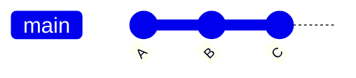
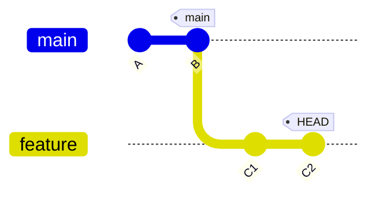
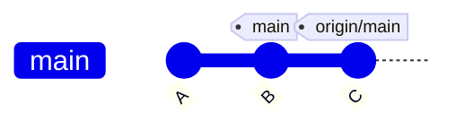
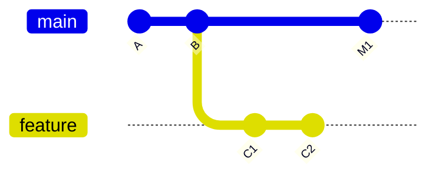
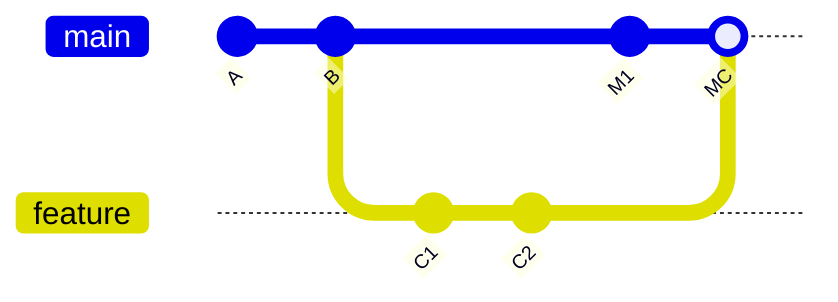
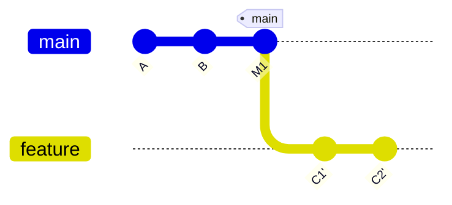
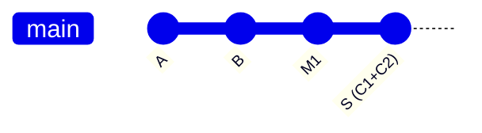
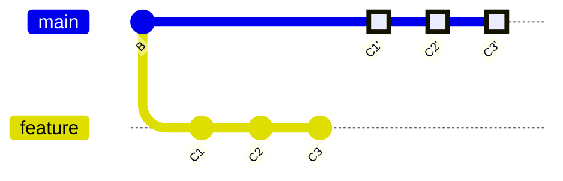

# git の基本概念

git は「コミットの連なり」と「それを指す名札(参照)」でできている。HEAD・ブランチ・origin はすべて名札の一種。

## コミット

コミットは、ある時点のファイル全体のスナップショットに、作者・日時・メッセージと**親コミットへのリンク**を付けたもの。親を辿ると履歴になる。



- 各コミットには中身から計算したハッシュ(`0064c0a...`)が付く。メッセージや親が 1 文字でも変わればハッシュも変わる
- コミットは変更できない。「書き換え」は新しいコミットを作り直して名札を付け替える操作

## 3 つの場所

```text
作業ツリー  ──git add──▶  インデックス  ──git commit──▶  リポジトリ(.git)
(編集中のファイル)        (次のコミットの予定)            (コミットの履歴)
```

| 場所 | 内容 |
|---|---|
| 作業ツリー | 実際に編集しているファイル |
| インデックス(ステージ) | 次のコミットに入れるもの。`git add` で選ぶ |
| リポジトリ | すべてのコミット(`.git` の中) |

## 参照(名札)

| 名札 | 実体 | 動き方 |
|---|---|---|
| ブランチ(`main` など) | `.git/refs/heads/<名前>` にハッシュ 1 行 | コミットすると新しいコミットへ自動で進む |
| HEAD | `.git/HEAD` | 「今いる場所」。普段はブランチを指す |
| タグ | `.git/refs/tags/<名前>` | 動かない固定の名札 |
| リモート追跡ブランチ(`origin/main`) | `.git/refs/remotes/origin/<名前>` | 最後に fetch した時点のリモートの状態 |

ブランチは「コミットの集まり」ではなく、**1 つのコミットを指す名札**。作るのも消すのも一瞬。



上の図では `main` は B、`feature` は C2 を指し、HEAD は `feature` にいる。

### HEAD

`.git/HEAD` は 1 行のファイル。

| 状態 | 中身 |
|---|---|
| ブランチにいる(通常) | `ref: refs/heads/<ブランチ名>` |
| detached HEAD(rebase 中、ハッシュやタグへの checkout) | コミットのハッシュそのもの |

ブランチにいる状態でコミットすると、HEAD が指すブランチが新しいコミットへ進む。detached HEAD でコミットするとどのブランチも進まず、別の場所へ移るとそのコミットは辿れなくなる。

| コマンド | 意味 |
|---|---|
| `git switch <ブランチ>` | HEAD をそのブランチに向ける |
| `git symbolic-ref --short -q HEAD` | 今のブランチ名を返す。detached HEAD なら何も出さず失敗する |
| `git rev-parse HEAD` | HEAD から辿ったコミットのハッシュを返す |
| `HEAD~1` / `HEAD^` | 今のコミットの親 |

## リモートと origin

リモートは別の場所(GitHub など)にある同じリポジトリの複製。`origin` は clone 元に自動で付く呼び名。

```text
手元(.git)                               GitHub(origin)
  main
  origin/main ◀──── git fetch ─────────── main
  feature ────────── git push ─────────▶ feature
```

| 操作 | 内容 |
|---|---|
| `git fetch` | リモートのコミットを取得し `origin/*` を更新する。自分のブランチは動かさない |
| `git pull` | fetch したうえで、自分のブランチを `origin/*` に合わせる |
| `git push` | 自分のコミットを送り、リモートのブランチを進める |

`main` と `origin/main` は別の名札。GitHub で PR をマージしても手元の `main` は進まないので、`git pull` で合わせる。



上の図は、fetch 後に `origin/main` だけが C に進み、手元の `main` が B に残っている状態。`git pull` で `main` も C へ進む。

ブランチごとに対応するリモートのブランチ(upstream)を持てる。`git branch -vv` の `[origin/main]` がそれ。リモートのブランチが消えると `[origin/...: gone]` になる。

## merge と rebase

どちらも分かれた 2 本の履歴を 1 本にまとめる操作。

出発点: `feature` を切って 2 コミットする間に、`main` も別の変更で M1 に進んだ。



### merge: 合流コミットを足す

```sh
git switch main
git merge feature
```



- 既存のコミットは変わらない(C1・C2 のハッシュはそのまま)
- 親を 2 つ持つ合流コミット MC ができ、「いつ何が合流したか」が残る
- 履歴は枝分かれと合流の形になる

### rebase: 作り直して積み直す

```sh
git switch feature
git rebase main
```



- C1・C2 の変更を M1 の上で再現し、**新しいコミット C1'・C2' を作る**。親が変わるのでハッシュも変わる
- 元の C1・C2 はどこからも参照されなくなる
- 履歴は一直線。このあと `main` を C2' まで進めるのは名札を動かすだけ(fast-forward)

### squash: 1 つにまとめる



ブランチのコミットを 1 つのコミット S にまとめて積む。コミットの粒度は失われる。

### 比較

| 観点 | merge | rebase | squash |
|---|---|---|---|
| 既存のコミット | そのまま | 作り直す(ハッシュが変わる) | 1 つにまとめる |
| 履歴の形 | 枝分かれと合流 | 一直線 | 一直線 |
| コミットの粒度 | 保つ | 保つ | 失う |
| 合流の記録 | 合流コミットで残る | 残らない | 残らない |
| コンフリクト解消 | 合流で 1 回 | コミットごとに順に | 1 回 |
| push 済みブランチ | そのまま push | force push が必要 | — |
| 取り消し | `git revert -m 1 <合流コミット>` で丸ごと | コミットごとに revert | S を revert |

### 共有済みのコミットは rebase しない

rebase はコミットを作り直す。他の人が持っているコミットを作り直すと、相手の手元の C1・C2 とこちらの C1'・C2' が別物として二重に存在してしまう。

- 自分だけの作業ブランチ: rebase して `git push --force-with-lease` してよい
- `main` などの共有ブランチ: rebase も force push もしない

## このリポジトリでの使い方

### 作業ブランチへの取り込みは rebase

作業中に `main` が進んだら、作業ブランチを rebase して追従する。作業ブランチに合流コミットが混ざらない。

```sh
git fetch
git rebase origin/main
git push --force-with-lease
```

### PR のマージは rebase のみ

条件は「コミットの粒度を変えない」と「`main` を一直線に保つ」。squash は粒度を失い、merge は枝分かれするので、両方を満たす rebase マージだけを許可している。



GitHub の「Rebase and merge」は、積み直す必要がない場合でも**必ずコミットを作り直す**(committer 情報が変わるため)。そのため:

- マージ後、ブランチ側と `main` 側でハッシュが異なり、`git branch -d` は「未マージ」と判定する。`git cherry main <ブランチ>` で全コミットが `-`(同じ変更が main にある)と確認してから `git branch -D` で消す
- どのコミットがどの PR から来たかは git の履歴に残らない。各コミットの `Refs: #<issue番号>` で辿る
