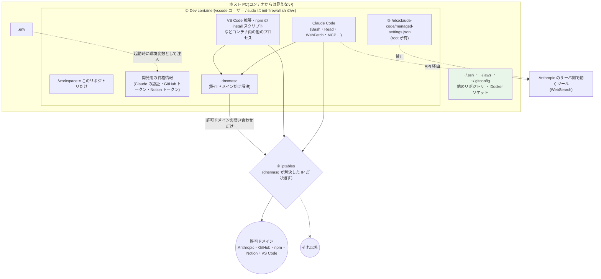
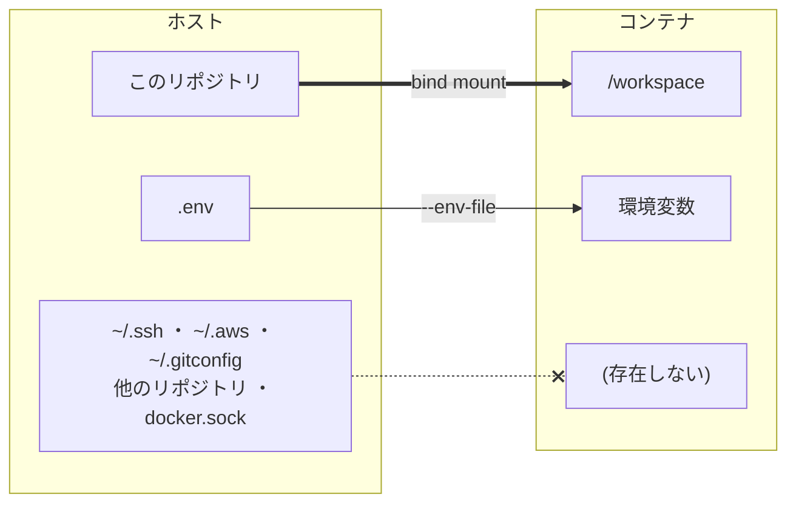
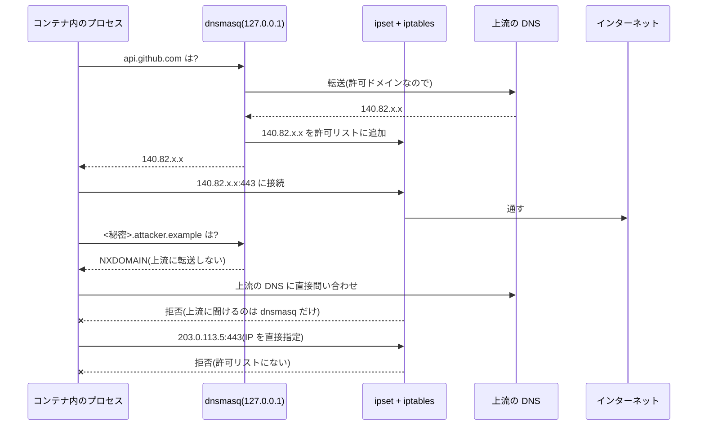

# 開発環境のセキュリティ境界

## 目的と前提

- **目的**: AI エージェント(Claude Code など)が、意図しない挙動(誤操作・プロンプトインジェクション)で
  秘密情報を外部に送信できないようにする。
- **前提**: AI エージェントは**開発にだけ**使う。エージェントの環境には開発用の最小権限の資格情報だけを置き、
  本番の資格情報・本番 DB・患者データは最初から存在しない。

秘密情報が外に出るには「**読める**」と「**第三者が受け取れる宛先に送れる**」の両方が要る。
この構成は主に後者を、エージェントが使うすべての経路について塞ぐ。

| 構成要素 | 役割 | 実体 |
|---|---|---|
| ① Dev container | 読めるものを開発用の最小限にする | `.devcontainer/devcontainer.json`・`Dockerfile` |
| ② ファイアウォール + DNS 許可リスト | コンテナ内の**全プロセス**の外向き通信を、許可ドメインだけにする | `.devcontainer/init-firewall.sh` |
| ③ Claude Code の管理設定 | ②を通らない経路(サーバ側で実行されるツール)を禁止する | `.devcontainer/managed-settings.json` |

Claude Code の sandbox(bubblewrap)は**使わない**(理由は末尾)。

## 全体像

## ① Dev container: 読めるものを減らす

- コンテナに渡すのは**このリポジトリと `.env` の中身だけ**。ホストの秘密鍵や他のリポジトリは存在しないので、読めない。
- `vscode` ユーザーの sudo は `init-firewall.sh` だけ。root になれないので、②を外せない。
- `NET_ADMIN` / `NET_RAW` は②の設定用で、root でなければ使えない。
- コンテナ内にある秘密(Claude の認証、`.env` のトークン、`gh` のトークン)は**読める前提**で扱い、権限を最小にする。

## ② ファイアウォール + DNS 許可リスト: 送れる宛先を絞る

- 外向き通信は「dnsmasq が許可ドメインとして解決した IP」宛てだけ通す。IP を直接指定しても届かない。
- DNS の問い合わせ自体にデータを載せる持ち出し(DNS トンネリング)も、許可外ドメインは上流に転送しないので届かない。
- 上流の DNS(Docker の内部 DNS `127.0.0.11` を含む)に問い合わせられるのは dnsmasq だけ。
- CDN の IP が変わっても、名前解決のたびに許可リストに追加されるので追従する。
- 例外として許可しているもの:
  - コンテナが属する Docker ネットワーク(compose で立てる PostgreSQL など)。ゲートウェイ(=ホスト)もこの範囲に含まれる。
  - compose のサービス名(ドットなしの名前)は Docker の内部 DNS に転送する。
- コンテナの起動時(`postStartCommand`)に適用する。必要なコマンドはすべてイメージに入れてあり、
  作成時(`postCreateCommand`)は通信を伴う処理をしない。通信が要る処理(`npm install` など)を足すときは `postStartCommand` のファイアウォールの後に置く。
- 許可ドメインの変更は `init-firewall.sh` を編集して rebuild する。**許可ドメインは持ち出し経路にもなるので、増やすときは PR で確認する。**

### 許可ドメイン

| 用途 | ドメイン(サブドメインを含む) |
|---|---|
| Claude Code | `api.anthropic.com`・`statsig.anthropic.com`・`statsig.com`・`sentry.io`・`claude.ai` |
| GitHub | `github.com`・`githubusercontent.com` |
| npm | `registry.npmjs.org` |
| Notion(ドキュメント用スキル) | `api.notion.com` |
| VS Code | `marketplace.visualstudio.com`・`vscode.blob.core.windows.net`・`update.code.visualstudio.com` |

`mcp-proxy.anthropic.com` は許可しない。claude.ai の MCP コネクタ(Slack・Gmail など)経由で外部サービスに送れてしまうため。

## ③ Claude Code の管理設定: ②を通らない経路を塞ぐ

- **WebSearch はコンテナの外(Anthropic のサーバ側)で実行される**ため、②では止まらない。検索語に秘密を入れられると外に出る。
  `managed-settings.json` で禁止する。
- 管理設定はイメージ内の root 所有のファイルで、コンテナ内からは書き換えられず、プロジェクトやユーザーの設定より優先される。
- WebFetch・Bash・MCP サーバはコンテナ内で実行されるので②の対象になり、個別に禁止する必要はない。

## プロジェクトの permissions(`.claude/settings.json`)を置かない理由

- エージェントは Dev container の中だけで動かす。ホストの秘密はコンテナに存在せず、コンテナ内の秘密は読めても②で送れない。
- permissions はツール名と引数の文字列で判定するだけで、Bash から同じことをされると止まらず、境界にならない。

## Claude Code の sandbox を使わない理由

- 目的(許可外の宛先に送れないこと)は②と③で、エージェント以外のプロセスも含めて満たせる。
  sandbox が上乗せできるのは Bash だけで、②と重複する。
- このホスト(Ubuntu、`kernel.apparmor_restrict_unprivileged_userns = 1`)ではホスト上で起動しない。
  コンテナ内で動かすには `seccomp=unconfined`・`apparmor=unconfined` でコンテナの隔離を緩める必要がある(2026-11-13 に確認)。

## 動作確認(2026-11-13、開発 PC)

この構成の `.devcontainer/` からビルドしたイメージで、`vscode` ユーザーとして確認した(VS Code からの起動ではなく `docker run`)。
compose 相当(ユーザー定義ネットワーク + PostgreSQL)と Docker の既定ネットワークの両方で同じ結果。

| 確認内容 | 期待 | 結果 |
|---|---|---|
| `https://api.github.com`・`registry.npmjs.org`・`api.anthropic.com`・`raw.githubusercontent.com` | 通る | 通る |
| `https://example.com` | 止まる | 止まる |
| IP を直接指定(`https://1.1.1.1`) | 止まる | 止まる |
| 許可外ドメインの名前解決 | 止まる | NXDOMAIN |
| `8.8.8.8`・上流の DNS・Docker の内部 DNS への直接の問い合わせ | 止まる | 止まる |
| compose のサービス名の解決と PostgreSQL(5432)への接続 | 通る | 通る |
| `sudo` で `init-firewall.sh` 以外を実行 | 止まる | 止まる |
| コンテナを再起動した後の再設定(上の項目も再起動後に同じ結果) | 成功 | 成功 |
| `claude`・`gh`・`ntn` がイメージに入っている | 使える | 使える |

## 残るリスクと運用ルール

| リスク | 対応 |
|---|---|
| 許可ドメインそのものが持ち出し経路になる(他人のトークンで GitHub に push、npm に publish、Anthropic API に送る) | 通信では防げない。コンテナに置くトークンを最小権限にし、許可ドメインを増やさない |
| **秘密をコミットしてこのリポジトリ(公開)に push する**(最も起こりやすい) | `.env` は `.gitignore` 済み。GitHub の push protection(secret scanning)を有効にし、pre-commit で秘密を検査する |
| `.env` のトークンはコンテナ内から読める | エージェントに使わせてよい最小権限のトークンだけを書く。GitHub はこのリポジトリだけに絞った fine-grained token |
| VS Code がホストの認証情報を転送する(Dev Containers 拡張の既定で、`~/.gitconfig`・git の認証ヘルパー・SSH エージェント) | ホストの VS Code 設定で止める(`dev.containers.copyGitConfig: false`、`dev.containers.gitCredentialHelperConfigLocation: "none"`、SSH エージェントの転送も止める)。git に必要な設定は下の「コンテナ内の認証」で作る |
| `.devcontainer/` や `.git/hooks/` を書き換えられ、次の rebuild やホストでの git 操作で反映される | ホストで git 操作や rebuild をする前に diff を確認する |
| ホスト(Docker ゲートウェイ)のサービスに届く | ホストでは、Docker のネットワークに開発に不要なサービスを公開しない |
| Claude の機能でアカウント内に保存する(Artifact など) | 送り先は自分の Anthropic アカウントの中なので、境界の内側として扱う |

## コンテナ内の認証

ホストの認証情報を転送しない代わりに、必要なものは `.env`(雛形は `.env.example`)から作る。
コンテナを作り直しても手作業は要らない。

| 対象 | 保存場所 | 作り直したとき |
|---|---|---|
| Claude Code | `/home/vscode/.claude`(名前付きボリューム `claude-code-config-${devcontainerId}`) | 残る。ログインし直すのは、ボリュームを消したときと、リポジトリのフォルダの場所を変えたとき(`devcontainerId` が変わる) |
| `gh` | 環境変数 `GH_TOKEN`(`.env`) | 残る(ログインしない) |
| git の push(HTTPS) | `gh auth setup-git` で `gh` を git の認証ヘルパーにする(`setup-git.sh`) | 作成時に自動で設定 |
| git の作者名・メール | `GIT_USER_NAME`・`GIT_USER_EMAIL`(`.env`) | 作成時に自動で設定(`setup-git.sh`) |
| Notion | `NOTION_API_TOKEN`(`.env`) | 残る |

`GH_TOKEN` はこのリポジトリだけに絞った fine-grained token にする。エージェントから読めるので、漏れた場合の被害をこのリポジトリに限るため。
